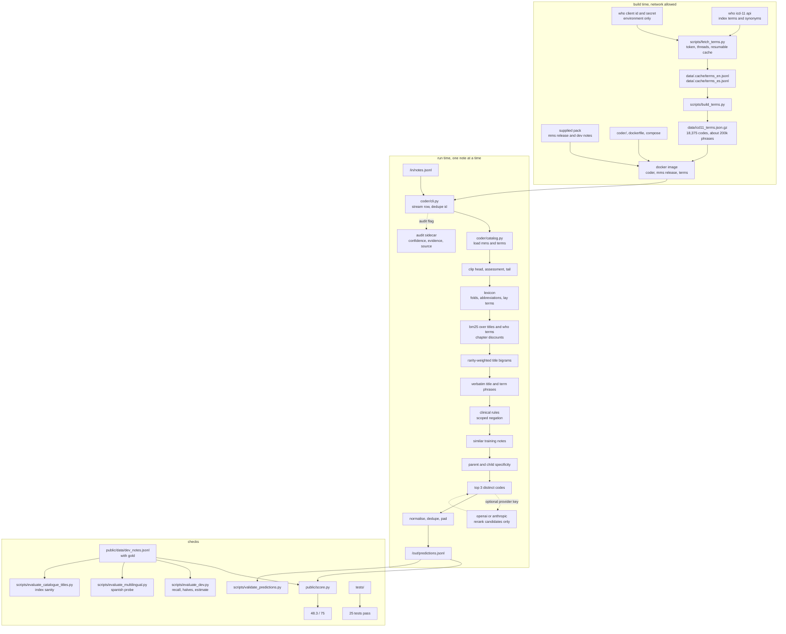

# icd-11 outpatient coder

reads an outpatient note and proposes up to three icd-11 mms 2026-01 codes, best first.
runs with no api key: a local ranker answers every id, and an openai or anthropic rerank is
optional.

## run

put notes at `in/notes.jsonl`, then:

```sh
docker compose build
docker compose run coder /in/notes.jsonl /out/predictions.jsonl
```

every id gets a line with up to three valid codes. `--audit` adds an optional sidecar with
confidence and evidence, without changing predictions. with no key nothing leaves the
machine. with a key, note text goes to the provider; call count, spend and deadline
are capped by environment variables.

## architecture and flow

the diagram is the whole project: what is built before the image, what happens to one note
at run time, and how the result is checked. the only run-time network call is the optional
model rerank.



the engine removes negated findings before ranking, and the optional model can only reorder
codes that already came back from the local ranker.

## dev score

```sh
python3 public/score.py --gold public/data/dev_notes.jsonl \
  --pred out/dev_predictions.jsonl --mms public/data/mms-2026-01.json
```

**48.3 / 75** on the 60 dev notes. top-1 is 0.617 (37/60), top-3 is 0.700 (42/60), with
zero missing and zero invalid codes. the two halves score 46.7 and 50.0. the first working
version scored 21.2/75.

a 600-note local run takes about 17 seconds, so the 60-minute limit is not close. i had no
provider key, so these numbers are the local ranker only; the model path is wired but
unmeasured.

hidden estimate: **55 to 64 / 100, low confidence**. the gain came from terminology rather
than tuning, which should travel, but only 25 of the 100 points are the generalisation
slice, and the shipped terms cover english and spanish only.

## data added

the only external data is the who icd-11 index terms, release 2026-01. a bearer token from
`icdaccessmanagement.who.int/connect/token` opens
`id.who.int/icd/release/11/2026-01/mms/<id>`, and `scripts/fetch_terms.py` reads each
category's index terms and synonyms. `scripts/build_terms.py` writes
`data/icd11_terms.json.gz` with 18,375 codes, about 200,000 phrases in english and spanish,
1.5 mb gzipped. it is built before the image and shipped inside it, so the graded run
makes no calls to the who api, and credentials stay in the environment. `coder/lexicon.py`
adds hand-written spelling variants, standard abbreviations and lay terms. the release,
the 60 notes and the scorer are the supplied pack; no other external data was added.

## evaluation beyond the 60 notes

leave-one-out candidate recall: the gold code is in the top 24 for 48/60 notes and the top
64 for 56/60, so perfect ranking there would score about 60/75. title lookup on 1,000
sampled categories scores 0.786 top-1 and 0.927 top-3, which checks the index, not clinical
accuracy. ten hand-translated spanish samples score 0.20 top-1 and 0.20 top-3 without
spanish terms, then 0.60 and 0.70 with them. the hidden set is unmeasured. the decision log
records the signals i dropped: coverage weighting, pseudo-relevance feedback, sharper idf,
k1 variants and neighbour weight.

## where the ai tooling was wrong

the "pad to three codes" step filtered a sorted 18,375-code catalogue against a growing
list, which is quadratic: 4.3 seconds per note, enough to put the 60-minute cap at risk on
600 notes. stage timing found it; the fix only touches the catalogue when a slot is
empty. a smaller one: the spelling fold stripped a trailing "s" from every word, turning
"tuberculosis" into "tuberculosi", and a lexicon test caught it.

## hours

9 to 10 hours.
