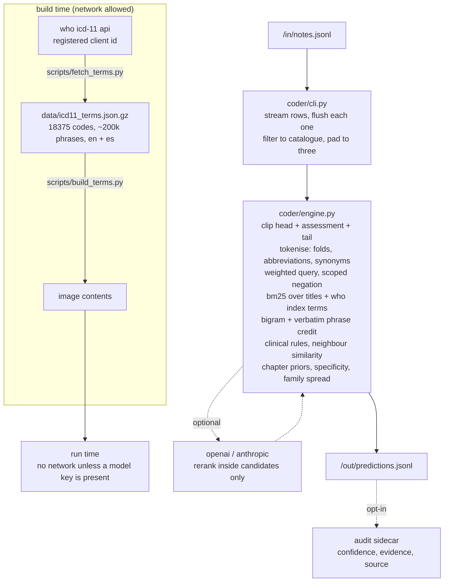

# icd-11 outpatient coder

reads an outpatient note and proposes up to three icd-11 mms 2026-01 codes, best first.
works with no api key: the local ranker answers every id, and the openai/anthropic rerank
is optional. graded command:

```sh
docker compose run coder /in/notes.jsonl /out/predictions.jsonl
```

## architecture



## dev score

`python3 public/score.py --gold public/data/dev_notes.jsonl --pred out/dev_predictions.jsonl --mms public/data/mms-2026-01.json`

**48.3 / 75** on the 60 dev notes: top-1 0.617, top-3 0.700, zero missing, zero invalid.
split-half scores 46.7 and 50.0, so it is not one lucky note. it started at 21.2.

hidden estimate: **55-64 / 100, low confidence**. the gain came from terminology rather
than tuning, which should transfer, but only 25 of the 100 points sit in the
different-distribution slice and the shipped artefact covers english and spanish only.

## data added, and where from

- **who icd-11 index terms**, release 2026-01, from the who icd api: a bearer token from
  `icdaccessmanagement.who.int/connect/token`, then one call per category to
  `id.who.int/icd/release/11/2026-01/mms/<id>` reading `indexTerm` and `synonym`.
  18,375 codes, about 200k phrases, english and spanish, shipped as one 1.5 mb gzipped
  file. `ICD_CLIENT_ID` and `ICD_CLIENT_SECRET` stay in the environment;
  `scripts/fetch_terms.py` (resumable, threaded, one connection per thread) then
  `scripts/build_terms.py` produce the file. build time only: the graded run touches no
  network.
- **clinical vocabulary** in `coder/lexicon.py`: spelling folds, standard abbreviations,
  lay synonyms. written by hand, no dataset, no licence question.
- nothing else. the release, the 60 notes and the scorer are the supplied pack.

## evaluation beyond the 60 dev notes

1. **candidate recall**, leave-one-out: gold is inside the top-24 candidates for 48 of 60
   notes, so perfect ranking inside that set would score about 60/75. that bounds the
   approach without hidden data.
2. **title lookup** on 1,000 sampled categories: 0.818 top-1, 0.935 top-3. catalogue
   indexing sanity, not clinical accuracy.
3. **non-english probe**: ten dev notes hand-translated into spanish, scored against their
   original gold codes. top-1 0.20 with english terms only, 0.60 once spanish terms were
   added. small sample, clear direction.
4. **rejected signals**, each with its number in `DECISIONS.md`: coverage weighting,
   pseudo-relevance feedback, sharper idf, k1 variants, neighbour weight.

## where the ai tooling was wrong

i let it write the "pad to three codes" step as a filter over a sorted 18,375-code
catalogue against a growing list. that is quadratic: 4.3 seconds per note, which would
have burned the 60-minute cap after roughly 200 of 600 notes. stage-by-stage timing, not
whole-run profiling, put the cost on that one line; the fix pads only when a slot is
genuinely empty. a smaller one: the spelling fold stripped a trailing "s" from every
word, turning "tuberculosis" into "tuberculosi". a lexicon test caught it.

## hours

9-10 hours.
